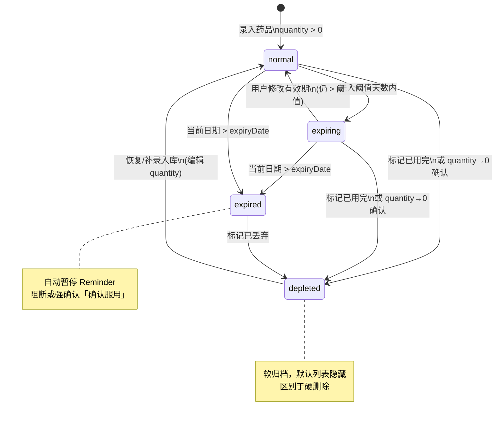
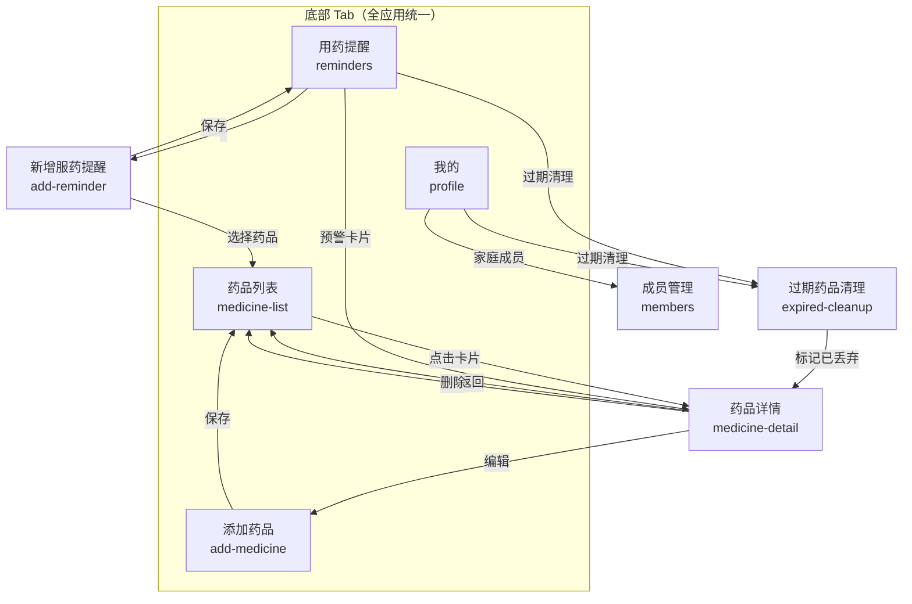

# 家药管家 — 产品需求文档（PRD）

> **文档版本：v1.1**  
> 生成日期：2026-06-21  
> 修订日期：2026-06-21  
> 项目状态：UI 原型阶段（4 个核心页面已完成）

### 修订记录（v1.0 → v1.1）

| 类别 | 修订内容 |
|------|----------|
| 概念澄清 | 拆分「用药提醒」（服药计划）与「过期提醒」（有效期预警），独立开关与数据字段 |
| 状态规则 | 统一过期阈值（全局默认 30 天）；状态优先级：已用完 > 已过期 > 即将过期 > 正常（互斥） |
| 数据闭环 | 「确认服用」联动 UsageRecord + 扣减 quantity；零库存/过期/已用完自动暂停服药提醒 |
| 生命周期 | 区分「已用完」（软归档）、「已丢弃」（过期处置）、「删除」（硬删除） |
| 字段对齐 | 拆分 initialQuantity / quantity；补全 unit、symptoms、storageLocation 等表单字段；支持同药不同批次 |
| UI/IA | 统一底部 Tab：药品 \| 添加 \| 提醒 \| 我的；移除重复添加入口；有效期改为「距过期天数」倒计时 |
| 新增流程 | 服药提醒创建流程、用药人字段、过期药品清理工作流 |
| 文案修正 | 临期提示改为「建议检查是否需要更换」；条码扫描仅填充产品信息，有效期须手动或 OCR |
| 新增章节 | 已知问题修订、药品条码/二维码与有效期获取方案、更新状态机与导航图 |

---

## 1. 项目概述

### 1.1 产品名称

**家药管家**（Home Medicine Manager）

### 1.2 产品定位

一款面向家庭的移动端药箱管理应用，帮助用户集中管理家中常备药品，追踪有效期，设置服药计划与过期预警，避免因药品过期或遗漏服药带来的健康风险。

### 1.3 核心价值

| 价值点 | 说明 |
|--------|------|
| 有效期可视化管理 | 通过颜色标签（绿/黄/红）与「距过期天数」快速识别药品状态 |
| 便捷录入 | 条码扫描填充产品信息 + 手动/OCR 录入有效期 |
| 服药提醒 | 独立服药计划时间轴，按时推送服药通知 |
| 过期预警 | 独立过期提醒开关，全局阈值可配置 |
| 全龄友好 | 大触控区域、高对比度信息展示，适配各年龄段用户 |

### 1.4 平台与形态

- **平台**：移动端（Mobile）
- **当前阶段**：UI 原型（HTML + Tailwind CSS）
- **目标设备宽度**：390px（iPhone 标准尺寸）

---

## 2. 目标用户与使用场景

### 2.1 目标用户

| 用户群体 | 典型场景 |
|----------|----------|
| 家庭管理者 | 定期整理药箱，清理过期药品，补充常备药 |
| 慢性病患者 / 家属 | 需要按时服药，记录用药历史，区分不同家庭成员用药 |
| 有老人/儿童的家庭 | 需要清晰标注用法用量、用药人与注意事项 |
| 健康意识用户 | 关注药品有效期，避免误服过期药 |

### 2.2 核心痛点

1. 家庭药箱药品杂乱，难以快速找到所需药品
2. 药品过期未被及时发现，存在误服风险
3. 长期用药容易忘记服药时间
4. 药品信息（用法、禁忌）分散在说明书上，查阅不便
5. 同一药品不同批次有效期不同，难以区分管理

---

## 3. 设计规范

### 3.1 视觉风格

- **主色调**：柔和薄荷绿（Emerald）+ 纯白
- **辅助色**：
  - 正常状态：绿色（`emerald`）
  - 即将过期：黄色/琥珀色（`amber`）
  - 已过期：红色（`red`）
  - 已用完：灰色（`gray`）
- **组件风格**：圆角卡片、清晰无衬线字体
- **字体**：`-apple-system, BlinkMacSystemFont, 'Segoe UI', sans-serif`

### 3.2 交互原则

- 所有可点击元素尺寸适配拇指操作（最小 44px 触控区域）
- 关键信息使用高对比度色块突出
- 卡片点击有 `active:scale-[0.98]` 按压反馈
- 底部 Tab 栏固定，全应用统一为 4 项

### 3.3 信息架构

```
底部 Tab 栏（全应用统一）
├── 药品（首页 — 药品列表）
├── 添加（添加药品）
├── 提醒（服药计划 + 过期预警）
└── 我的（设置、家庭成员、统计等）

独立页面
├── 药品详情
├── 编辑药品（复用添加表单）
├── 新增/编辑服药提醒
└── 过期药品清理（可从提醒页或我的页进入）
```

**添加入口规范（单一模式）**

| 入口 | 行为 |
|------|------|
| 底部 Tab「添加」 | **唯一主入口**，进入 `add-medicine` |
| 药品列表页 | **不再**使用悬浮「+」按钮，避免与 Tab 重复 |
| 提醒页「+」 | 进入「新增服药提醒」流程（选择已有药品 → 配置计划），**不是**添加药品 |

---

## 4. 功能模块详述

### 4.1 药品列表（首页）

**页面 ID**：`medicine-list`  
**入口**：应用默认首页，底部 Tab「药品」

#### 功能描述

查看家中所有在库药品及其有效期状态，快速识别即将过期或已过期物品。默认隐藏「已用完」软归档药品。

#### 功能清单

| 功能 | 优先级 | 说明 |
|------|--------|------|
| 药品卡片列表 | P0 | 展示缩略图、名称、剩余数量、有效期标签 |
| 搜索 | P0 | 支持按药品名称或症状/用途关键词搜索 |
| 状态筛选 | P0 | 全部 / 即将过期 / 已过期 / 正常 |
| 状态标签 | P0 | 绿色=正常，黄色=即将过期，红色=已过期，灰色=已用完 |
| 跳转详情 | P0 | 点击卡片进入药品详情页 |
| 底部 Tab 导航 | P0 | 药品、添加、提醒、我的（4 项统一） |
| 查看已用完 | P1 | 筛选或「我的」中查看软归档药品 |

#### 药品卡片信息字段

- 缩略图
- 药品名称
- 适用症状/用途描述（`symptoms`）
- 剩余数量 + 单位（如「12 粒」）
- 过期日期
- 距过期天数（临期/过期时突出显示）
- 状态标签
- 存放位置（可选，列表次要展示）

#### 筛选 Chip 展示

- 全部 (N)
- 即将过期 (N)
- 已过期 (N)
- 正常 (N)

> **批次规则**：同一药品名称 + 不同有效期 = 独立卡片（独立 `Medicine` 记录），列表可显示批次/有效期以区分。

#### 页面跳转

- → `add-medicine`（Tab「添加」）
- → `medicine-detail`（点击卡片）
- → `reminders`（Tab「提醒」）
- → `profile`（Tab「我的」）

---

### 4.2 添加药品

**页面 ID**：`add-medicine`  
**入口**：底部 Tab「添加」（唯一主入口）

#### 功能描述

录入新药品信息。条码扫描仅自动填充产品信息（名称、规格、厂家等），**有效期必须**由用户手动选择或通过 OCR 辅助录入并确认。

#### 功能清单

| 功能 | 优先级 | 说明 |
|------|--------|------|
| 条码扫描 | P0 | 扫描 EAN/UPC 条码，查库填充名称、规格、厂家（**不含有效期**） |
| 追溯码扫描 | P2 | 扫描 20 位药品追溯码，尝试 API 获取批次与有效期（见 §12） |
| 有效期 OCR | P1 | 拍摄包装有效期区域，OCR 识别后须用户确认 |
| 手动填写表单 | P0 | 条码不可用时的完整录入方式 |
| 表单校验 | P0 | 必填字段未填时阻止保存 |
| 距过期天数预览 | P1 | 选择有效期后显示「距过期还有 X 天」 |
| 过期提醒开关 | P1 | `expiryNotifyEnabled`：开启后在全局阈值内推送过期预警 |
| 保存加载态 | P1 | 保存时显示 Loading 遮罩 |
| 返回列表 | P0 | 保存成功后返回药品列表 |

#### 数据字段

**必填字段**

| 字段 | 类型 | 示例 | 说明 |
|------|------|------|------|
| 药品名称 | 文本 | 阿莫西林胶囊 | |
| 规格 | 文本 | 0.5g×24粒/盒 | |
| 单位 | 枚举 | 粒 / 片 / 袋 / 瓶 | 数量展示与扣减单位 |
| 入库数量 | 数字 | 24 | `initialQuantity`，首次录入 |
| 剩余数量 | 数字 | 24 | `quantity`，初始等于入库数量，服用后递减 |
| 有效期至 | 日期 | 2026-06-30 | **必须手动或 OCR 确认**，条码不可自动填充 |
| 适用症状/用途 | 文本 | 感冒发热、咽喉痛 | `symptoms`，列表搜索用 |
| 存放位置 | 文本 | 卧室床头柜 | `storageLocation` |

**选填字段**

| 字段 | 类型 | 示例 |
|------|------|------|
| 购入日期 | 日期 | 2024-12-15 | 可选，不再用于进度条计算 |
| 用法用量 | 文本 | 每日3次，每次1粒，饭后服用 |
| 备注 | 多行文本 | 特殊储存条件等 |
| 分类标签 | 多选标签 | 抗生素、感冒药、止痛药、肠胃药、外用药、维生素、自定义 |
| 批次号 | 文本 | 20240101 | 同药不同批次区分 |

**系统字段（扫码/API 可填充，均选填）**

- 生产厂家（`manufacturer`）
- 批准文号（`approvalNumber`）
- OTC/处方药标识（`isOTC`）
- 英文名称（`nameEn`）
- 条码（`barcode`）
- 追溯码（`traceCode`）

#### 分类标签预设

抗生素、感冒药、止痛药、肠胃药、外用药、维生素，支持自定义添加。

#### 过期提醒开关说明

- 字段名：`expiryNotifyEnabled`（**不是**服药提醒）
- 开启后：在全局「即将过期」阈值（默认 30 天）内发送本地推送
- 与「服药计划 Reminder」完全独立，互不替代

#### 页面跳转

- ← `medicine-list`（Tab「药品」/ 保存后返回）

---

### 4.3 药品详情

**页面 ID**：`medicine-detail`

#### 功能描述

查看单条药品（含批次）的完整信息及历史记录，执行编辑、标记已用完、标记已丢弃或删除操作。

#### 功能清单

| 功能 | 优先级 | 说明 |
|------|--------|------|
| 药品大图展示 | P0 | 顶部 Hero 区域展示药品图片 |
| 基础信息卡片 | P0 | 规格、厂家、批准文号、购入日期、存放位置、批次号 |
| 有效期倒计时 | P0 | 显示「距过期 X 天」及日期，**不用**购入→过期进度百分比 |
| 过期预警提示 | P0 | 临期/过期时显示醒目警告卡片 |
| 用法用量折叠面板 | P1 | 可展开/收起的详细用法说明 |
| 注意事项折叠面板 | P1 | 禁忌、副作用、储存条件等 |
| 使用记录时间轴 | P1 | 入库、服用、标记用完、已丢弃等历史事件 |
| 关联服药提醒 | P1 | 展示并跳转该药品的 Reminder 列表 |
| 分享 | P2 | 右上角分享按钮 |
| 标记已用完 | P0 | 软归档，quantity 置 0 |
| 标记已丢弃 | P1 | 过期药品处置记录 |
| 编辑 | P0 | 进入编辑模式（复用添加药品表单） |
| 删除 | P0 | 硬删除（需二次确认） |

#### 基础信息字段

- 规格
- 生产厂家
- 批准文号
- 购入日期（选填）
- 存放位置
- 批次号（若有）
- 入库数量 / 剩余数量 + 单位
- OTC/处方药标识

#### 有效期展示（取代原「进度条」）

- **主展示**：距过期天数倒计时（如「还有 45 天」/「已过期 3 天」）
- **辅展示**：有效期至日期
- **视觉层次**（与全局状态规则一致，仅 UI 强调程度不同）：
  - ≤ 2 天：红色高亮 + 「紧急」标签
  - 3–7 天：琥珀色 + 「注意」标签
  - 8–30 天（阈值内）：黄色提示
  - > 30 天：正常绿色
- **临期/过期文案**：「将于 X 天后过期，**建议检查是否需要更换**」（不区分药品类型统一表述，避免误导性「尽快使用」）

#### 使用记录类型

| 事件类型 | 记录内容 | 系统联动 |
|----------|----------|----------|
| 入库登记（`stock_in`） | 首次录入数量 | 创建 Medicine |
| 服用（`intake`） | 剂量、时间、用药人、备注 | 扣减 `quantity`，创建 UsageRecord |
| 标记已用完（`depleted`） | 消耗完毕 | `status=depleted`，`quantity=0`，暂停关联 Reminder |
| 已丢弃（`disposed`） | 过期处置 | `status=depleted` 或独立标记，记录处置时间 |

#### 底部操作栏

| 操作 | 类型 | 说明 |
|------|------|------|
| **已用完** | 软归档 | 标记消耗完毕；从默认列表隐藏；可恢复编辑 |
| **已丢弃** | 过期处置 | 针对已过期药品；记录处置事件；从默认列表隐藏 |
| **编辑** | 主操作 | 修改药品信息 |
| **删除** | 危险操作 | 永久删除记录及关联 Reminder（二次确认） |

#### 不可用状态交互

当 `status` 为 `expired`、`depleted` 或 `quantity = 0` 时：

- 关联的服药 Reminder **自动暂停**（`enabled = false`）
- 提醒页「确认服用」**禁用**或弹出强确认（「药品已过期/已用完，确认仍要记录？」）
- 详情页展示原因说明条

#### 页面跳转

- ← `medicine-list`（返回）
- → `add-medicine`（编辑模式）
- → `add-reminder`（从关联提醒进入）

---

### 4.4 用药提醒

**页面 ID**：`reminders`  
**入口**：底部 Tab「提醒」

#### 功能描述

**本页包含两类独立功能**，分区展示：

1. **服药计划**（`Reminder`）：按时服药的时间轴与确认
2. **过期预警**（`expiryNotifyEnabled`）：临期/过期药品卡片列表

> ⚠️ **概念区分**：「用药提醒」= 服药计划推送；「过期提醒」= 有效期预警推送。二者数据源、开关、通知文案均不同。

#### 功能清单

| 功能 | 优先级 | 说明 |
|------|--------|------|
| 今日服药计划时间轴 | P0 | 按时间排序的待服/已服药品列表 |
| 服药确认 | P0 | 「确认服用」→ UsageRecord + 扣减 quantity |
| 零库存提示 | P0 | quantity 扣减至 0 时弹窗引导「标记已用完」 |
| 今日进度 | P1 | 已完成 X/Y 进度条 |
| 即将过期预警区 | P0 | 阈值内到期药品高亮（视觉分级见下） |
| 新增服药提醒 | P0 | 右上角「+」→ 新增 Reminder 流程 |
| 过期药品清理入口 | P1 | 已过期药品批量查看与处置引导 |
| 日期切换 | P1 | 查看其他日期的服药计划 |
| 通知状态提示 | P1 | 底部 Banner 说明两类通知策略 |
| 跳转药品详情 | P0 | 点击预警卡片进入详情 |

#### 新增服药提醒流程

```
提醒页「+」
  → 选择药品（仅 status=normal|expiring 且 quantity>0 的可选）
  → 配置：时间 / 每次剂量 / 重复规则（星期）/ 服用方式 / 用药人
  → 保存 Reminder（enabled=true）
```

| 配置项 | 说明 |
|--------|------|
| 时间 | HH:mm，可多条 |
| 每次剂量 | 如「2 粒」，与 Medicine.unit 一致 |
| 重复规则 | 星期多选（0=周日 … 6=周六） |
| 服用方式 | 饭前 / 饭后 / 随餐 |
| 用药人 | 家庭成员姓名或标签（见 §4.6） |

#### 今日服药计划

每条计划包含：

- 服用时间（如 08:00、12:30）
- 药品名称
- 剂量（如：每次 2 粒）
- 服用方式（如：饭后服用）
- 用药人（如：爸爸）
- 状态：已服用 / 待服用 / 即将到来

时间轴状态样式：

- **已服用**：绿色实心圆 + 勾选图标
- **当前待服**：绿色边框 + 脉冲动画 + 高亮卡片 + 确认按钮
- **即将到来**：灰色空心圆

#### 「确认服用」数据流（闭环）

```
用户点击「确认服用」
  1. 校验：Medicine.status ∈ {normal, expiring} 且 quantity > 0
     └─ 否则：阻断或强确认
  2. 创建 UsageRecord（type=intake, dosage, memberId, recordedAt）
  3. Medicine.quantity -= 计划剂量（整数扣减）
  4. 若 quantity == 0：
     └─ 弹窗：「库存已空，是否标记为已用完？」
     └─ 确认 → status=depleted，暂停所有关联 Reminder
  5. 刷新时间轴状态为「已服用」
```

#### 即将过期预警区

**底层规则**：与全局阈值一致（默认 30 天内为 `expiring`）。本区仅做**视觉紧急度分级**，不改变 status 计算。

| 视觉紧急度 | 条件（在 expiring 状态下） | 展示方式 |
|------------|---------------------------|----------|
| 紧急 | ≤ 2 天 | 渐变橙红背景 + 「仅剩 X 天」红色标签 |
| 警告 | 3–7 天 | 白色背景 + 琥珀色标签 |
| 一般 | 8–30 天 | 浅色背景 + 黄色标签 |

预警卡片信息：药品名称、有效期至、剩余数量、存放位置  
预警文案：「建议检查是否需要更换」（统一表述）

#### 过期药品清理工作流

```
提醒页 / 我的页 →「过期药品清理」
  → 列出 status=expired 的全部药品
  → 每条可选：查看详情 / 标记已丢弃 / 删除
  → 批量操作（P2）：全选标记已丢弃
```

#### 通知策略

| 类型 | 触发条件 | 提前量 | 开关 |
|------|----------|--------|------|
| 服药提醒 | Reminder.enabled 且对应时间点 | 默认 15 分钟 | 全局 + 单条 Reminder |
| 过期提醒 | expiryNotifyEnabled 且进入 expiring | 阈值内每日/一次 | 全局 + 单条 Medicine |

#### 底部 Tab 导航

与全应用统一：**药品 | 添加 | 提醒 | 我的**

#### 页面跳转

- → `medicine-list`（Tab「药品」）
- → `add-medicine`（Tab「添加」）
- → `add-reminder`（「+」新增服药提醒）
- → `medicine-detail`（预警卡片 / 计划条目）
- → `profile`（Tab「我的」）
- → `expired-cleanup`（过期清理）

---

### 4.5 我的

**页面 ID**：`profile`  
**入口**：底部 Tab「我的」

#### 功能描述

用户设置、家庭成员、数据统计及过期清理入口。

#### 功能清单

| 功能 | 优先级 | 说明 |
|------|--------|------|
| 过期预警天数 | P1 | 全局「即将过期」阈值，**默认 30 天** |
| 通知开关 | P0 | 全局推送总开关 |
| 服药提醒提前时间 | P1 | 默认 15 分钟，可调整 |
| 家庭成员 / 用药人 | P1 | 添加、编辑、删除成员（姓名、关系、头像） |
| 过期药品清理 | P1 | 跳转过期清理工作流 |
| 已用完药品 | P1 | 查看软归档列表，可恢复 |
| 数据备份/导出 | P2 | 导出药品清单 |
| 关于 / 隐私政策 | P2 | 应用信息 |

> **说明**：原「设置」页功能合并至「我的」，不再作为独立 Tab。

---

### 4.6 家庭成员 / 用药人

**数据实体**：`Member`（见 §5.5）

#### 使用场景

- 创建服药 Reminder 时选择「用药人」
- UsageRecord 记录实际服药成员
- 未来版本：按成员统计用药历史

#### 功能（P1）

| 功能 | 说明 |
|------|------|
| 添加成员 | 姓名、关系（本人/父亲/母亲/孩子/其他）、可选头像 |
| 编辑 / 删除 | 删除时关联 Reminder 的 memberId 置空 |
| 默认成员 | 首次使用引导创建「本人」 |

---

## 5. 数据模型

### 5.1 药品（Medicine）

```typescript
interface Medicine {
  id: string;
  name: string;                      // 药品名称
  nameEn?: string;                   // 英文名称
  specification: string;             // 规格
  unit: '粒' | '片' | '袋' | '瓶' | string;  // 单位
  initialQuantity: number;           // 入库数量（首次录入，不变）
  quantity: number;                  // 剩余数量（服用后递减）
  expiryDate: Date;                  // 有效期至（须手动或 OCR 确认）
  purchaseDate?: Date;               // 购入日期（选填）
  symptoms: string;                  // 适用症状/用途（必填）
  storageLocation: string;           // 存放位置（必填）
  usage?: string;                    // 用法用量
  notes?: string;                    // 备注
  tags: string[];                    // 分类标签
  manufacturer?: string;             // 生产厂家
  approvalNumber?: string;           // 批准文号
  isOTC?: boolean;                   // 是否非处方药
  batchNumber?: string;              // 批次号（同药不同批次区分）
  imageUrl?: string;                 // 药品图片
  barcode?: string;                  // 商品条码（EAN/UPC）
  traceCode?: string;                // 药品追溯码（20 位）
  precautions?: string[];            // 注意事项列表
  expiryNotifyEnabled: boolean;      // 过期提醒开关（非服药提醒）
  status: MedicineStatus;            // 计算字段，见 §5.6
  archivedAt?: Date;                 // 软归档时间（已用完/已丢弃）
  archiveReason?: 'depleted' | 'disposed';  // 归档原因
  createdAt: Date;
  updatedAt: Date;
}

type MedicineStatus = 'normal' | 'expiring' | 'expired' | 'depleted';
```

**批次规则**：相同 `name` + 不同 `expiryDate`（或 `batchNumber`）= 独立 `Medicine` 记录，不做合并。

### 5.2 用药记录（UsageRecord）

```typescript
interface UsageRecord {
  id: string;
  medicineId: string;
  type: 'intake' | 'stock_in' | 'depleted' | 'disposed';
  dosage?: string;                   // 剂量描述（如「2 粒」）
  memberId?: string;                 // 用药人
  notes?: string;                    // 备注（如：头痛，饭后服用）
  recordedAt: Date;
}
```

### 5.3 服药提醒（Reminder）

> **命名约定**：`Reminder` 专指**服药计划**，与 `expiryNotifyEnabled`（过期提醒）严格区分。

```typescript
interface Reminder {
  id: string;
  medicineId: string;
  memberId?: string;                 // 用药人
  time: string;                      // HH:mm 格式
  dosage: string;                    // 每次剂量（如「1 粒」）
  instruction: '饭前' | '饭后' | '随餐' | string;
  repeatDays: number[];              // 重复星期：0=周日, 1=周一...
  enabled: boolean;                  // 过期/用完/零库存时系统自动置 false
  pausedReason?: 'expired' | 'depleted' | 'zero_quantity' | 'manual';
  createdAt: Date;
  updatedAt: Date;
}
```

### 5.4 应用设置（AppSettings）

```typescript
interface AppSettings {
  expiringThresholdDays: number;     // 即将过期阈值，默认 30
  intakeNotifyLeadMinutes: number;   // 服药提醒提前分钟，默认 15
  notificationsEnabled: boolean;       // 全局通知开关
}
```

### 5.5 家庭成员（Member）

```typescript
interface Member {
  id: string;
  name: string;                      // 姓名
  relation: 'self' | 'father' | 'mother' | 'child' | 'other';
  avatarUrl?: string;
  createdAt: Date;
}
```

### 5.6 状态计算规则

**优先级（互斥，按顺序匹配第一条）**：

```
1. depleted   — archiveReason ∈ {depleted, disposed} 或 quantity <= 0 且用户确认已用完
2. expired    — 当前日期 > expiryDate（且非 depleted）
3. expiring   — expiryDate >= 当前日期 且 expiryDate <= 当前日期 + expiringThresholdDays
4. normal     — expiryDate > 当前日期 + expiringThresholdDays
```

| 状态 | 条件 | 列表默认可见 | 可确认服用 | 服药 Reminder |
|------|------|-------------|-----------|---------------|
| `depleted` | 已用完/已丢弃/quantity=0 且确认 | 否（归档区） | 否（强确认） | 自动暂停 |
| `expired` | 当前日期 > 有效期 | 是（过期筛选） | 否（强确认） | 自动暂停 |
| `expiring` | 距过期 ≤ 阈值 | 是 | 是 | 正常 |
| `normal` | 距过期 > 阈值 | 是 | 是 | 正常 |

**说明**：

- `expiringThresholdDays` 从 `AppSettings` 读取，默认 **30 天**
- 提醒页视觉分级（≤2 天 / 3–7 天 / 8–30 天）仅影响 UI 样式，**不改变**上述 status 枚举
- 状态应随日期变化每日重算（本地定时或 App 启动时）

### 5.7 状态机



---

## 6. 页面导航关系



---

## 7. 非功能性需求

### 7.1 性能

- 药品列表加载时间 < 1 秒（100 条以内）
- 搜索响应延迟 < 300ms（本地过滤）
- 条码扫描识别 < 3 秒
- OCR 识别反馈 < 5 秒（含网络）

### 7.2 可用性

- 支持 iOS / Android 主流机型
- 最小触控区域 44×44 pt
- 文字对比度符合 WCAG AA 标准
- 支持系统字体缩放

### 7.3 数据与安全

- 本地优先存储（离线可用）
- 敏感健康数据加密存储
- 可选云同步（未来版本）
- 不涉及处方开具，仅做信息管理

### 7.4 通知

- 支持本地推送（服药提醒、过期预警，独立通道）
- 用户可全局关闭通知
- 通知内容不含完整处方信息

---

## 8. 外部依赖（待选型）

| 能力 | 用途 | 候选方案 |
|------|------|----------|
| 条码扫描 | 识别 EAN/UPC 商品码 | 原生相机 API / ZXing / ML Kit |
| 追溯码查询 | 20 位追溯码 → 批次/有效期 | 阿里健康 API / 国家医保平台（P2） |
| 药品数据库 | 条码 → 名称/规格/厂家 | 国家药监局 / 阿里健康 / 京东 / 自建库 |
| OCR | 包装有效期区域识别 | ML Kit / Google Vision / Azure OCR / Tesseract |
| 本地存储 | 药品数据持久化 | SQLite / IndexedDB / AsyncStorage |
| 推送通知 | 服药/过期提醒 | 系统本地通知 / FCM / APNs |

---

## 9. 当前项目状态

### 9.1 已完成

| 交付物 | 状态 |
|--------|------|
| 药品列表 UI 原型 | ✅ Ready（待对齐 Tab 与字段） |
| 添加药品 UI 原型 | ✅ Ready（待对齐字段与文案） |
| 药品详情 UI 原型 | ✅ Ready（待改进度条为倒计时） |
| 用药提醒 UI 原型 | ✅ Ready（待拆分概念与补流程） |
| 页面间导航（原型级） | ✅ Ready（待统一 Tab） |
| 设计规范定义 | ✅ Ready |

### 9.2 未完成

| 模块 | 状态 |
|------|------|
| 我的页面 | ❌ 未设计 |
| 新增服药提醒页面 | ❌ 未设计 |
| 过期药品清理页 | ❌ 未设计 |
| 成员管理页 | ❌ 未设计 |
| 编辑药品页面 | ❌ 可复用添加页 |
| 后端 / 数据层 | ❌ 未实现 |
| 条码扫描功能 | ❌ 未实现 |
| OCR 有效期识别 | ❌ 未实现 |
| 推送通知 | ❌ 未实现 |

### 9.3 技术栈（当前原型）

- HTML5
- Tailwind CSS（CDN）
- 纯静态页面，无框架、无状态管理

---

## 10. 版本规划建议

### v1.0 — MVP（最小可行产品）

- [ ] 药品 CRUD（增删改查）
- [ ] 有效期状态自动计算与筛选（互斥优先级）
- [ ] 本地数据存储
- [ ] 基础搜索（含 symptoms）
- [ ] 过期本地通知（`expiryNotifyEnabled`）
- [ ] 统一 4 Tab 导航
- [ ] 手动录入 + 条码查产品信息
- [ ] 有效期手动选择 + 可选 OCR 辅助

### v1.1 — 用药管理

- [ ] 服药计划 Reminder CRUD
- [ ] 服药确认闭环（UsageRecord + 扣减 quantity）
- [ ] 今日服药时间轴
- [ ] 用药人 / 家庭成员
- [ ] 已用完 / 已丢弃 / 删除 生命周期
- [ ] 过期药品清理工作流

### v1.2 — 便捷录入增强

- [ ] 药品追溯码扫描（API 查批次/有效期）
- [ ] OCR 有效期识别优化
- [ ] 同药多批次快速录入

### v2.0 — 家庭协作

- [ ] 家庭成员共享药箱
- [ ] 云同步
- [ ] 数据导出

---

## 11. 已知问题修订（v1.0 审查结论）

以下为 v1.0 文档与原型中的问题及 v1.1 修正对照：

| # | 原问题 | v1.1 修正 |
|---|--------|-----------|
| 1 | 「用药提醒」与「过期提醒」概念混用，`reminderEnabled` 语义不清 | 拆分：`Reminder`=服药计划；`expiryNotifyEnabled`=过期预警 |
| 2 | 过期阈值在添加页写死 30 天，提醒页又用 7 天展示 | 统一全局阈值默认 30 天；提醒页 7 天内仅为视觉分级 |
| 3 | status 中 `depleted` 与 `expired` 可能并存 | 明确互斥优先级：depleted > expired > expiring > normal |
| 4 | 「确认服用」未定义扣减库存 | 补充完整数据流：UsageRecord + quantity-- + 零库存引导 |
| 5 | 过期/用完药品仍可确认服用 | 自动暂停 Reminder，阻断或强确认 |
| 6 | 「已用完」与「删除」未区分 | 已用完=软归档；已丢弃=过期处置；删除=硬删除+确认 |
| 7 | 添加表单缺 unit、symptoms、storageLocation | 补全必填字段；manufacturer/approvalNumber 选填 |
| 8 | 仅 quantity 无 initialQuantity | 拆分入库量与剩余量 |
| 9 | 同药不同批次未说明 | 独立 Medicine 记录，列表分卡片展示 |
| 10 | Tab 栏不统一（列表 3 项 vs 提醒 4 项） | 全应用统一：药品 \| 添加 \| 提醒 \| 我的 |
| 11 | 添加入口重复（悬浮+ vs Tab） | 仅 Tab「添加」为主入口；提醒页「+」仅新增 Reminder |
| 12 | 有效期「购入→过期」进度条误导 | 改为「距过期天数」倒计时；购入日期选填 |
| 13 | 临期文案「建议尽快使用」不准确 | 统一为「建议检查是否需要更换」 |
| 14 | 条码扫描暗示可填有效期 | 明确：条码仅填 name/spec/manufacturer；有效期须手动/OCR |
| 15 | 缺服药提醒创建流程 | 补充 §4.4 新增 Reminder 流程 |
| 16 | 缺用药人字段 | 新增 Member 实体，Reminder/UsageRecord 关联 |
| 17 | 缺过期清理流程 | 补充 expired-cleanup 工作流 |
| 18 | 设置与我的 Tab 重复预留 | 合并为「我的」单 Tab |

---

## 12. 药品条码/二维码与有效期获取方案

### 12.1 核心结论：标准条码能否识别有效期？

**不能。** 常见商品条码（EAN-13、UPC-A）仅编码**产品 SKU**（全球贸易项目代码），标识「这是什么药、什么规格」，**不包含**批次号或有效期。有效期是**批次级**信息，印刷在包装其他位置，与条码相互独立。

```
┌─────────────────────────────────────────────┐
│  药品包装盒典型信息布局                        │
├─────────────────────────────────────────────┤
│  [EAN-13 条码]  →  产品身份（全批次通用）       │
│  批号：20240101  →  生产批次（每批不同）         │
│  有效期至：2026-06  →  批次级（每批不同）        │
│  [追溯码 20位]  →  最小包装单元唯一标识         │
│  [QR 二维码]    →  厂商自定义，格式不统一        │
└─────────────────────────────────────────────┘
```

**各码类型对照**：

| 码类型 | 编码内容 | 能否直接得有效期 | 家药管家用途 |
|--------|----------|-----------------|-------------|
| EAN-13 / UPC | 产品 GTIN | ❌ | 查药品数据库 → 填 name/spec/manufacturer |
| 厂商 QR 码 | 厂商自定义 URL/文本 | ⚠️ 个别厂商含批次信息，**无统一标准** | P2 探索，不可依赖 |
| GS1 DataMatrix | 可含 GTIN+批号+有效期（GS1 标准） | ✅ 理论上可以 | 国内药品包装采用率低 |
| 药品追溯码（20位） | 最小包装唯一标识 | ✅ 可通过 API 查批次/有效期 | P2，需企业 API 资质 |
| NFC / 智能包装 | 芯片存储 | ✅ 可能含 | 家用药品极少，未来提及 |

### 12.2 有效期获取：技术方案对比

#### 方案 1：手动录入（Baseline）

用户查看包装印刷的有效期，在日期选择器中选择。

| 维度 | 评估 |
|------|------|
| 优点 | 100% 可靠；无网络依赖；实现最简单；用户有确认感知 |
| 缺点 | 操作步骤多；易输错；体验不够「智能」 |
| 实现复杂度 | ⭐ 低 |
| 推荐阶段 | **MVP 必须**，始终作为最终确认环节 |

#### 方案 2：OCR 拍照识别

用户拍摄包装「有效期至」区域，OCR 引擎提取日期文本，经用户确认后写入。

| 维度 | 评估 |
|------|------|
| 优点 | 比纯手输快；适应各种包装排版；离线可用（端侧 ML Kit） |
| 缺点 | 光照/模糊/反光导致误识别；中日期格式多样（2026-06、2026.06.30、EXP 06/2026）；**必须人工确认** |
| 技术选型 | 端侧：Apple Vision / Google ML Kit；云端：Google Cloud Vision、Azure Document Intelligence、百度 OCR |
| 实现复杂度 | ⭐⭐⭐ 中 |
| 推荐阶段 | **MVP 可选**（拍照 → OCR 建议值 → 用户确认） |

**OCR UX 要点**：

- 取景框引导对准「有效期至」区域
- 识别结果预填日期控件，高亮「待确认」
- 低置信度（< 0.8）提示「请手动核对」
- 支持常见格式正则校验与标准化

#### 方案 3：条码查库 + 手动有效期

扫描 EAN-13 → 查询药品数据库 → 自动填充 name、specification、manufacturer、approvalNumber → 用户**仍须**手动/OCR 录入 expiryDate。

| 维度 | 评估 |
|------|------|
| 优点 | 大幅减少打字；产品信息准确 |
| 缺点 | 数据库覆盖率有限（进口药、小众药、拆零药）；查不到时需全手动 |
| 数据源 | 国家药监局公开数据、阿里健康 open API、京东健康、自建 crowdsource 库 |
| 实现复杂度 | ⭐⭐ 中低 |
| 推荐阶段 | **MVP 核心**（scan → lookup → manual expiry） |

#### 方案 4：GS1 DataMatrix / 药品追溯码

**GS1 DataMatrix**：符合 GS1 标准的二维条码可在单个码内编码 `(01)GTIN + (17)有效期 + (10)批号`，但国内零售药品包装较少采用此格式。

**中国药品追溯码**（「药品身份证」）：

- 通常为 **20 位数字**，标识最小销售包装单元
- 2024 年起国家推进全品种赋码；医保平台已支持扫码验真
- 消费者扫码可获：药品名称、规格、生产企业、**生产日期、有效期、批号**
- 技术对接：阿里健康 `alibaba.alihealth.drug.code.kyt.querycode` 等 API，需企业资质与 `ref_ent_id`
- 限制：需 API 密钥与商业合作；并非所有历史库存药品都有码；OTC 小包装覆盖仍在推进

| 维度 | 评估 |
|------|------|
| 优点 | 可自动获取批次+有效期，体验最佳 |
| 缺点 | API 准入门槛；覆盖率非 100%；需区分追溯码 vs 普通 EAN |
| 实现复杂度 | ⭐⭐⭐⭐ 高 |
| 推荐阶段 | **v1.2+**（作为增强，手动/OCR 仍为 fallback） |

#### 方案 5：NFC / 智能包装

部分高端或实验性包装内置 NFC 芯片，可存储批次与有效期。

| 维度 | 评估 |
|------|------|
| 优点 | 读取准确、可重复读取 |
| 缺点 | 家用 OTC 药品几乎不存在；需硬件支持 |
| 实现复杂度 | ⭐⭐⭐⭐⭐ |
| 推荐阶段 | **未来版本**，文档提及即可 |

#### 方案 6：AI 视觉（LLM / 多模态模型）

拍摄整张药品包装，视觉模型理解标签并提取名称、规格、有效期、批号等。

| 维度 | 评估 |
|------|------|
| 优点 | 对复杂排版、多语言标签适应性强；一次拍照提取多字段 |
| 缺点 | 需网络与 API 成本；幻觉风险；延迟较高；隐私顾虑 |
| 实现复杂度 | ⭐⭐⭐ 中（API 集成）至 ⭐⭐⭐⭐（端侧模型） |
| 推荐阶段 | **v1.2+ 探索**（与 OCR 互补，整图理解场景） |

### 12.3 方案选型矩阵

| 方案 | 准确性 | 覆盖率 | 离线 | 开发成本 | MVP | v1.1 | v1.2+ |
|------|--------|--------|------|----------|-----|------|-------|
| 手动录入 | ★★★★★ | ★★★★★ | ✅ | 低 | ✅ 必须 | ✅ fallback | ✅ fallback |
| 条码 + 查库 | ★★★★☆ | ★★★☆☆ | ⚠️ 查库需网络 | 中低 | ✅ 核心 | ✅ | ✅ |
| OCR 有效期 | ★★★☆☆ | ★★★★☆ | ✅ 端侧 | 中 | ✅ 可选 | ✅ 增强 | ✅ |
| 追溯码 API | ★★★★★ | ★★★☆☆ | ❌ | 高 | ❌ | ❌ | ✅ |
| AI 整图识别 | ★★★☆☆ | ★★★★☆ | ❌ | 中 | ❌ | ⚠️ 探索 | ✅ |
| NFC | ★★★★★ | ★☆☆☆☆ | ✅ | 高 | ❌ | ❌ | ❌ |

### 12.4 推荐 MVP 录入流程（家药管家）

```
┌──────────────┐
│  添加药品入口  │
└──────┬───────┘
       ▼
┌──────────────┐     成功      ┌─────────────────────┐
│ 扫描商品条码   │ ──────────→ │ 查库填充：            │
│ (EAN-13)     │              │ name, spec,         │
└──────┬───────┘              │ manufacturer,       │
       │ 失败/无码             │ approvalNumber      │
       ▼                      └──────────┬──────────┘
┌──────────────┐                          │
│ 手动输入      │ ←────────────────────────┘
│ 产品信息      │
└──────┬───────┘
       ▼
┌──────────────────────────────────────┐
│ 有效期录入（二选一，均需用户确认）       │
│  A. 日期选择器手动选择                  │
│  B. 拍摄有效期区域 → OCR 建议 → 确认    │
└──────┬───────────────────────────────┘
       ▼
┌──────────────┐
│ 补全必填字段   │
│ unit, qty,   │
│ symptoms,    │
│ location     │
└──────┬───────┘
       ▼
┌──────────────┐
│ 可选：开启    │
│ expiryNotify │
│ Enabled      │
└──────┬───────┘
       ▼
     保存
```

**关键原则**：

1. **条码永远不自动写入 `expiryDate`**，避免静默错误导致用药安全风险
2. OCR/AI 结果仅为「建议值」，保存前必须经用户确认
3. 查库失败时优雅降级为全手动，不阻断流程
4. v1.2 可增加「扫描追溯码」分支，成功时预填 expiryDate + batchNumber，**仍须用户确认**

---

## 13. 附录

### 13.1 原型文件对照

| 页面 | 原型文件 | v1.1 待调整 |
|------|----------|-------------|
| 入口索引 | `index.html` | Tab 统一 |
| 药品列表 | `untitled-medicine-list.html` | 移除悬浮+，对齐 Tab |
| 添加药品 | `untitled-add-medicine.html` | 字段补全，拆分提醒开关 |
| 药品详情 | `untitled-medicine-detail.html` | 进度条→倒计时 |
| 用药提醒 | `untitled-reminders.html` | 概念拆分，补+流程 |
| 项目配置 | `project.json` | — |

### 13.2 术语表

| 术语 | 说明 |
|------|------|
| OTC | Over-The-Counter，非处方药，无需处方即可购买 |
| 临期 / 即将过期 | 距离过期日期 ≤ 全局阈值（默认 30 天）的药品，status=`expiring` |
| 批准文号 | 国家药监局颁发的药品注册编号 |
| 规格 | 药品的单次剂量与包装数量描述 |
| 用药提醒 | 服药计划（Reminder），按时间点推送服药通知 |
| 过期提醒 | 有效期预警（expiryNotifyEnabled），临期/过期时推送 |
| 追溯码 | 20 位药品唯一标识，可关联批次与有效期（需 API） |
| 已用完 | 软归档，quantity=0，默认列表隐藏，可恢复 |
| 已丢弃 | 过期药品处置记录，软归档 |
| 删除 | 硬删除，不可恢复，需二次确认 |

---

*本文档 v1.1 基于 v1.0 产品审查结论修订，后续开发过程中请同步更新。*
